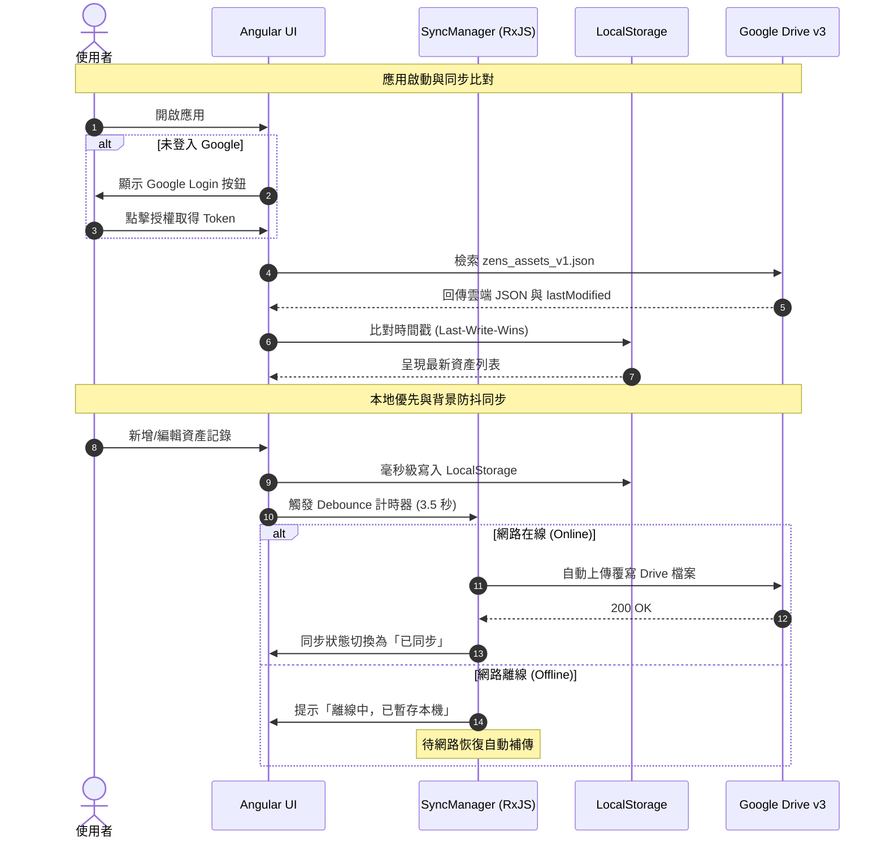

# 專案遷移規格書 (Migration Project Specification)

## 1. 專案概述 (Project Overview)
本專案為 **Zens Manage 資產管理系統** 的純前端 (Serverless / No-Backend) 架構遷移版本。旨在提供使用者一個極致輕量、高隱私且具備離線操作能力的個人財務與資產追蹤工具。

系統採用 **Local-First (本地優先)** 原則：
* **身分驗證**: 透過 Google Identity Services (OAuth 2.0) 進行個人身分認證。
* **資料儲存**: 使用者的個人 Google Drive 作為永久且唯一的雲端儲存中心，瀏覽器端的 LocalStorage 進行即時讀寫與快取。
* **零伺服器維護**: 移除原有 Node.js (Koa) 後端與 SQLite 資料庫，不儲存任何使用者憑證或私密財務資料於第三方伺服器。
* **交付產物**: Multi-stage Docker Image (Node.js 20 build -> Nginx Alpine 靜態部署)。

---

## 2. 技術堆疊 (Technology Stack)
* **前端框架**: Angular 20 (TypeScript, RxJS, Signals)
* **UI 元件庫**: Angular Material (主題風格無縫接軌原 Material-UI 視覺體驗)
* **身分驗證**: Google Identity Services (GIS SDK - OAuth 2.0 Token Client)
* **雲端儲存**: Google Drive API v3 (RESTful API, Scope: `https://www.googleapis.com/auth/drive.file`)
* **本機儲存**: Web Storage API (LocalStorage，預留未來擴充 IndexedDB)
* **資料視覺化**: ngx-echarts / Chart.js (資產趨勢折線圖)
* **日期處理**: date-fns 或原生 JavaScript Date (取代肥大的 Moment.js)
* **容器化部署**: Docker (Multi-stage build), Nginx (Alpine-based)

---

## 3. 系統架構與資料流 (System Architecture)

```mermaid
graph TD
    User([使用者瀏覽器]) -->|1. Google 授權| GIS[Google Identity Services]
    GIS -->|2. Access Token| User
    User <-->|3. 即時讀寫 (Local-First)| Cache[(LocalStorage)]
    User <-->|4. 防抖同步 / 啟動比對 (JSON)| Drive[(Google Drive API v3)]
    Docker[Docker / Nginx Alpine] -.->|純靜態託管| User
```

### 資料同步時序流程 (Sync Lifecycle)


---

## 4. 核心功能規格 (Core Features)

### 4.1 身分驗證模組 (Authentication)
* **Google Identity Services (GIS)**:
  * 首次進入系統時引導使用者授權登入。
  * **最低權限要求 (Least Privilege Scope)**: 僅請求 `https://www.googleapis.com/auth/drive.file`（僅能存取該應用建立的檔案，無法存取使用者 Drive 內的其他私密檔案）。
* **Token 生命週期管理**:
  * 記憶體/SessionStorage 儲存短期 Token。
  * 偵測 Token 過期 (401 錯誤) 時，自動觸發重新靜默獲取或提示重新授權。

### 4.2 資料管理與同步模組 (Local-First Sync Engine)
* **儲存目標檔案**: `zens_assets_v1.json`（位於使用者的 Google Drive 根目錄或應用特定資料夾）。
* **版本比對策略 (Last-Write-Wins)**:
  * 本地與雲端皆帶有 `lastModified` (ISO 8601) 時間戳記。
  * 應用啟動時，若雲端檔案較新則更新本地；若本地較新則排程上傳。
* **背景防抖自動同步 (Debounce Save)**:
  * 本地更新後延遲 3~5 秒觸發上傳，防止高頻率連續編輯造成過量 API 呼叫。
* **手動同步支援**:
  * Header 提供「立即強制同步」按鈕與旋轉同步狀態指示器 (Sync Indicator)。
* **同步狀態指示**:
  * `Synced`（綠色/已同步最新）
  * `Pending`（橘色/待同步，正在等待防抖時間或上傳中）
  * `Offline`（灰色/離線中，變更已存本機）
  * `Error`（紅色/同步發生異常，提供手動重試）

### 4.3 資產管理業務功能 (Asset Management Features)
* **資產記錄列表 (Asset List)**:
  * 按日期排序記錄。
  * 每列顯示：日期 (Date)、資產總額 (Total)、操作按鈕 (編輯/刪除)。
  * **明細展開 (Expandable Row)**: 點擊箭頭可即時展開該筆記錄的各子項目清單 (Item Name & Value)。
* **資產記錄新增/編輯 (Asset Dialog)**:
  * 日期選擇器。
  * 資產子項目明細 (動態增加、刪除 Item、即時計算 Total 總合)。
  * **自動預載功能 (Load Last Items)**: 新增資產時，系統自動帶入「最後一筆資產記錄」的項目名稱與架構，大幅節省使用者重複輸入資產項目的時間。
* **資產趨勢分析圖表 (Asset Trend Chart)**:
  * 依日期先後繪製折線圖。
  * 支援千分位數值格式化 (Tooltip 與 Y 軸 K/M 簡化標籤)。
* **舊資料匯入/匯出 (Data Migration & Backup)**:
  * 支援手動匯入 JSON 檔案（相容舊系統 SQLite 轉換之 `exported_assets.json`）。
  * 支援一鍵將當前資料匯出為本機 JSON 備份。

---

## 5. 資料結構規格 (Data Schema Specification)

```typescript
export interface AssetItem {
  id: string;          // 項目唯一識別碼 (UUID 或 字串)
  name: string;        // 資產名稱 (例如：台幣活存、富邦證券、美股)
  value: number;       // 金額數值
}

export interface AssetRecord {
  id: string;          // 唯一識別碼 (UUID 或 字串)
  date: string;        // 記錄日期 (格式: YYYY-MM-DD)
  items: AssetItem[];  // 明細項目清單
  total: number;       // 總額 (自動加總 items.value)
  createdAt: string;   // 建立時間 (ISO 8601)
  updatedAt: string;   // 更新時間 (ISO 8601)
}

export interface ZensAppData {
  schemaVersion: number;    // 結構版本號 (當前為 1)
  lastModified: string;     // 全域最後更新時間戳 (ISO 8601)
  deviceId: string;         // 寫入端識別碼 (避免自我衝突)
  assets: AssetRecord[];    // 所有歷史資產記錄
  settings?: {
    currency?: string;
    autoSyncDebounceMs?: number;
  };
}
```

---

## 6. 舊架構淘汰與清理清單 (Deprecation & Cleanup)

遷移後，下列舊架構組件完全廢棄並自專案中移除：
1. **後端服務 (`backend/`)**:
   - Koa.js 框架、Nodemon、Supertest
   - SQLite 資料庫 (`database.sqlite`) 與 Sequelize 模型 (`Asset.js`, `AssetItem.js`, `User.js`)
   - JWT 驗證中間件 (`auth.js`) 與 bcryptjs 密碼加密
   - 用戶管理控制器與路由 (`userController.js`, `userRoutes.js`)
2. **舊前端冗餘組件 (`frontend/`)**:
   - React 19、Vite、React Router、MUI
   - 全站使用者管理頁面 (`UserManagement.jsx`, `UserDialog.jsx`)
   - 伺服器登入頁 (`Login.jsx` 原帳號密碼登入邏輯)

---

## 7. 部署規劃 (Docker & Nginx)

### 7.1 Multi-Stage Dockerfile
* **Stage 1 (Builder)**: 使用 `node:20-alpine`，執行 Angular 20 生產構建 (`ng build --configuration production`)。
* **Stage 2 (Runtime)**: 使用 `nginx:alpine`，將建置產物複製至 `/usr/share/nginx/html`。

### 7.2 Nginx 配置要點 (`docker/nginx.conf`)
* **SPA 路由支援**: `try_files $uri $uri/ /index.html;` 避免刷新 404。
* **快取原則**:
  * `index.html`: `Cache-Control: no-cache, no-store, must-revalidate`。
  * `*.js`, `*.css`, 圖片: `Cache-Control: public, max-age=31536000, immutable`。
* **安全性標頭**: X-Frame-Options, X-Content-Type-Options 等。

---

## 8. 舊資料轉移與安全性規範 (Legacy Data Migration)
1. **資料來源**: 原系統 Docker volume (`docker_zens_data`) 內之 `database.sqlite`。
2. **備份與驗證**:
   - 已完成完整備份（包含 26 筆歷史資產記錄、177 筆資產項目），已轉存為 `backup_data/exported_assets.json`。
   - `backup_data/` 及 `*.sqlite` 需納入 `.gitignore`，嚴禁敏感財務資料外洩。
3. **無縫匯入機制**:
   - 新系統啟動且完成 Google 登入後，若偵測為初次使用（Drive 無檔案且 LocalStorage 為空），提供「匯入既有備份 (JSON)」引導，一鍵將 `exported_assets.json` 上傳至使用者的 Google Drive，確保歷史資產資料完整延續。

---

## 9. 前置準備與憑證設定 (Prerequisites)
1. **Google Cloud Console**:
   * 建立專案並啟用 **Google Drive API**。
   * 配置 OAuth 同意畫面（新增授權範圍 `.../auth/drive.file`）。
   * 建立 Web Application Client ID，設定授權的 JavaScript 來源：
     * `http://localhost:4200` (開發環境)
     * 正式部署之網域名稱或 IP。
2. **環境變數 (`src/environments/environment.ts`)**:
   * `googleClientId`: 填入 GCP 申請之 OAuth 2.0 Client ID。